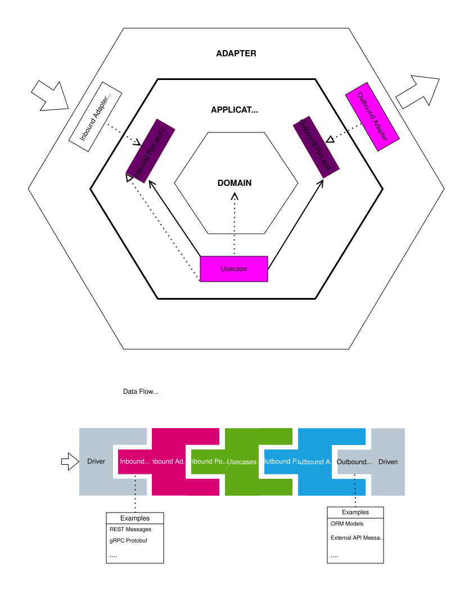

# Ports and Adapters Guidelines

A practical guide to implementing the Ports and Adapters (Hexagonal Architecture) pattern in Go and Python.

It decouples core business logic from external infrastructure, delivering systems that are testable, maintainable, and resilient to change.


In this approach, the focus is placed on strict decoupling and clarity of logic, never sacrificing clean boundaries for the sake of simpler code generation. With code generation becoming increasingly easier using agents, reducing boilerplate is no longer a reason to compromise architectural design. The primary goal is **predictability of implementation in each layer**—ensuring consistent, well-defined responsibilities and seamless maintainability.




## Folders Structure
- **[cmd/](docs/cmd.md)**: Application entry points (composition roots).
        - ...
- **[configs/](docs/configs.md)**: Configuration templates and environment settings.
- **[scripts/](docs/configs.md)**: Utility and deployment scripts.
- **[internal/](docs/internal.md)**: Main application code, including core logic and adapters.
    - **[core/](docs/internal_core.md)**: The heart of the application, containing domain logic and application use cases.
        - **[domain/](docs/domain.md)**: Pure business entities, value objects, and domain services.
        - **[application/](docs/internal_core_application.md)**: Orchestration logic and system use cases.
            - **[ports/](docs/port.md)**: Interfaces defining contracts for inbound and outbound communication.
                - **[inbound/](docs/inbound_port.md)**: Interfaces defining what the system can do.
                - **[outbound/](docs/outbound_port.md)**: Interfaces defining what the system needs from external systems.
            - **[usecases/](docs/usecase.md)**: Implementations of the inbound ports.
    - **[adapters/](docs/adapters.md)**: Interaction with the external world.
        - **[inbound/](docs/inbound_adapter.md)**: Driving adapters (e.g., HTTP, gRPC, CLI, AMQP, ...).
        - **[outbound/](docs/outbound_adapter.md)**: Driven adapters (e.g., SQL, MongoDB, Redis, External APIs, AMQP, ...).

## Domain Development

The architecture does not mandate a single domain modeling style. Depending on the complexity of the business logic, we have the flexibility to choose the most suitable approach.

### Examples:

- **Anemic / Data-Centric (Low Complexity)**: Simple data structures with minimal behavior, ideal for CRUD-heavy operations or simple workflows where logic lives primarily within use cases.
- **Rich Domain Model (Moderate Complexity)**: Entities encapsulate both **data and behavior**, enforcing their own invariants, validations, and state mutations.
- **Domain-Driven Design (High Complexity)**: Full tactical DDD (Aggregates, Entities, Value Objects, Domain Events, and Domain Services) to tackle intricate rules and strict consistency boundaries.
- **State Machine / Workflow-Driven**: Explicit state transitions and event-driven modeling for systems with complex lifecycles and strict state validation.
- ...

## Scale

The structure should stay small for a small service and grow with the codebase. Start flat and add another level only when one directory holds too many unrelated things. Each top-level directory can grow on its own. The pattern is the same everywhere: **group by purpose first, then by detail**.

### cmd/

Start with one entry point. As more runtimes appear (API server, worker, CLI, migrations), give each one its own directory. Each one stays a thin composition root that wires its adapters together.

```
cmd/                        cmd/
└── main.go          ──►    ├── api/          # HTTP/gRPC server
                            │   └── main.go
                            ├── worker/       # AMQP / queue consumers
                            │   └── main.go
                            ├── cli/          # admin / ops commands
                            │   └── main.go
                            └── migrate/      # schema migrations
                                └── main.go
```

### configs/

Start with one config file. As the number of environments and components grows, split the files by **environment** and then by **component**. Defaults live in one base file, and each environment overrides only what it needs.

```
configs/                    configs/
└── config.yaml      ──►    ├── base.yaml             # shared defaults
                            ├── local/
                            │   ├── app.yaml
                            │   └── database.yaml
                            ├── staging/
                            │   └── app.yaml
                            └── production/
                                ├── app.yaml
                                └── database.yaml
```

### scripts/

Start with a few scripts at the top level. As they pile up, group them by **purpose**. Keep a single entry point (`Makefile` / `Taskfile`) so people don't need to know the internal layout.

```
scripts/                    scripts/
├── build.sh         ──►    ├── build/
├── test.sh                 │   ├── docker.sh
└── deploy.sh               │   └── binary.sh
                            ├── ci/
                            │   ├── lint.sh
                            │   └── test.sh
                            ├── deploy/
                            │   ├── staging.sh
                            │   └── production.sh
                            └── dev/
                                ├── seed.sh
                                └── setup.sh
```

### internal/

The core and the adapters scale on their own. Split the **core** by business module (bounded context) once one domain gets too large. Split the **adapters** by technology. The ports keep both sides independent.

```
internal/core/                      internal/adapters/
├── domain/                         ├── inbound/
│   ├── order/                      │   ├── http/
│   ├── payment/                    │   ├── grpc/
│   └── user/                       │   └── amqp/
└── application/                    └── outbound/
    ├── ports/                          ├── postgres/
    │   ├── inbound/                    ├── redis/
    │   └── outbound/                   └── stripe/
    └── usecases/
        ├── order/
        ├── payment/
        └── user/
```

### Other directories

The same rule applies to every other directory as it appears, for example:

- **deployments/**: Split by target (`docker/`, `k8s/`, `terraform/`), then by environment.
- **api/**: Contract definitions (OpenAPI, Protobuf, AsyncAPI), split by protocol and then by version (`v1/`, `v2/`).
- **migrations/**: Split by datastore (`postgres/`, `mongo/`) when there is more than one.
- **test/**: Split by test type (`integration/`, `e2e/`, `fixtures/`). Unit tests stay next to the code they test.
- **docs/**: Split by audience or topic (`architecture/`, `adr/`, `runbooks/`).
- ...

> **Rule of thumb:** Don't create a level before you need it. Add one when a directory has too many unrelated files, or when a team or module needs a clear boundary.

