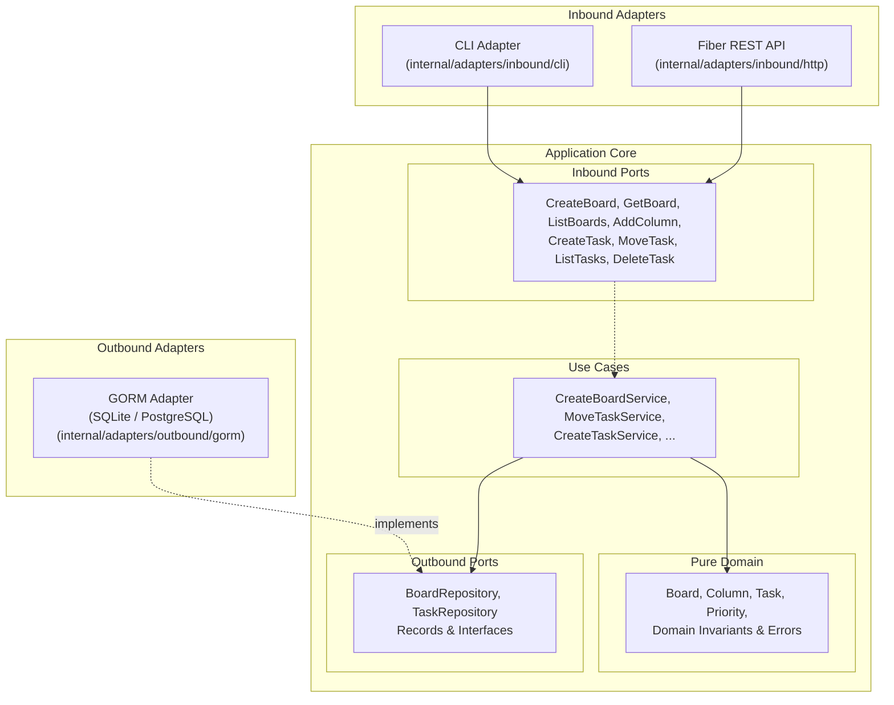

# Simple Task Management — Hexagonal Architecture (Golang)

A reference implementation of the **[Simple Task Management Specification](../../sample-projects/simple-task-management.md)** using the **Ports and Adapters (Hexagonal Architecture)** pattern in Go.

The system manages Kanban boards, customizable workflow columns, and tasks, with strict business invariant enforcement including **Work-in-Progress (WIP) limits** per column. It provides dual interaction interfaces (**REST API powered by Fiber** and **CLI**) and switchable relational persistence (**SQLite** and **PostgreSQL** via **GORM**).

---

## Table of Contents

- [Architectural Principles](#architectural-principles)
- [Folder Structure](#folder-structure)
- [Layers & Decoupling](#layers--decoupling)
- [Getting Started](#getting-started)
  - [Prerequisites](#prerequisites)
  - [Local Installation](#local-installation)
- [Running the System](#running-the-system)
  - [1. Running the REST API (Fiber)](#1-running-the-rest-api-fiber)
  - [2. Running the CLI Interface](#2-running-the-cli-interface)
  - [3. Running with Docker & Docker Compose](#3-running-with-docker--docker-compose)
- [CLI Usage Examples](#cli-usage-examples)
- [REST API Endpoints & Examples](#rest-api-endpoints--examples)
- [Switchable Persistence (SQLite / PostgreSQL with GORM)](#switchable-persistence-sqlite--postgresql-with-gorm)
- [Testing & Architecture Verification](#testing--architecture-verification)

---

## Architectural Principles

This project adheres strictly to the Ports and Adapters guidelines documented in this repository:

1. **Dependency Inversion**: Dependencies always point inward toward the core:
   - `core/domain`: Standard library only. No ORM, no framework, no third-party tags.
   - `core/application/ports`: Contracts and DTOs; standard library only.
   - `core/application/usecases`: Implements inbound ports; depends only on domain and ports.
   - `adapters`: Depends only on ports. Inbound adapters depend on inbound ports; outbound adapters implement outbound ports.
   - `bootstrap`: Composition root; wires concrete dependencies and configuration.
2. **Domain Isolation**: Domain entities (`Board`, `Column`, `Task`, `Priority`) and domain errors contain pure business logic and invariants. Domain types never leak outside the core.
3. **Dedicated Port DTOs**: Input and output Data Transfer Objects are defined explicitly at the ports boundary to decouple transport and database models from core entities.
4. **Parity Between Interfaces**: Both the Fiber REST API and CLI adapter interact through identical use case inbound ports.
5. **Architectural Verification**: Boundary contracts are enforced using `.golangci.yml` with `depguard`.



---

## Folder Structure

```
sample-projects/golang/simple-task-management/
├── bootstrap/                                # Application composition roots
│   ├── api/
│   │   └── main.go                           # REST API composition root & Fiber server entrypoint
│   └── cli/
│       └── main.go                           # CLI composition root & command runner entrypoint
├── configs/                                  # Configuration management
│   ├── base.yaml                             # Default configuration values
│   └── config.go                             # Configuration loader (YAML files + env vars)
├── internal/
│   ├── core/                                 # Pure business logic and orchestration
│   │   ├── domain/                           # Core business entities and rules (Standard Library only)
│   │   │   ├── board/                        # Board & Column entities, domain errors
│   │   │   │   ├── entities.go
│   │   │   │   ├── entities_test.go
│   │   │   │   └── errors.go
│   │   │   └── task/                         # Task entity, Priority enum, domain errors
│   │   │       ├── entities.go
│   │   │       ├── entities_test.go
│   │   │       └── errors.go
│   │   └── application/                      # Use cases and port contracts
│   │       ├── ports/
│   │       │   ├── inbound/                  # Inbound port interfaces, DTOs & errors
│   │       │   │   ├── board/                # create_board, get_board, list_boards, add_column
│   │       │   │   └── task/                 # create_task, move_task, list_tasks, delete_task
│   │       │   └── outbound/                 # Outbound repository contracts & DTOs
│   │       │       ├── board/                # BoardRepository interface, BoardRecord
│   │       │       └── task/                 # TaskRepository interface, TaskRecord
│   │       └── usecases/                     # Inbound port implementations
│   │           ├── board/                    # CreateBoardService, AddColumnService, ...
│   │           └── task/                     # MoveTaskService (WIP checks), CreateTaskService, ...
│   └── adapters/                             # Technical infrastructure & interaction adapters
│       ├── inbound/                          # Driving adapters
│       │   ├── http/                         # Fiber REST API adapter (routes, handlers, errors)
│       │   │   ├── server.go
│       │   │   ├── dtos.go
│       │   │   ├── errors.go
│       │   │   ├── board_handler.go
│       │   │   └── task_handler.go
│       │   └── cli/                          # CLI adapter (subcommands & tabwriter formatters)
│       │       ├── app.go
│       │       ├── formatters.go
│       │       ├── board_commands.go
│       │       ├── column_commands.go
│       │       ├── task_commands.go
│       │       └── cli_test.go
│       └── outbound/                         # Driven adapters
│           └── gorm/                         # GORM persistence adapter (SQLite & Postgres)
│               ├── database.go               # Dialector selection & AutoMigrate
│               ├── models.go                 # GORM models (BoardModel, ColumnModel, TaskModel)
│               ├── mappers.go                # Maps between GORM models and Outbound Records
│               ├── board_repository.go       # BoardRepository implementation
│               └── task_repository.go        # TaskRepository implementation
├── scripts/                                  # Utility scripts
│   ├── run_api.sh                            # Script to run Fiber API server
│   ├── run_cli.sh                            # Script to run CLI commands
│   └── test.sh                               # Test suite runner
├── test/
│   └── integration/                          # Integration tests (GORM & Fiber HTTP)
│       ├── gorm_repository_test.go
│       └── fiber_http_test.go
├── .golangci.yml                             # Depguard architectural boundary enforcement
├── Dockerfile                                # Multi-stage production Dockerfile
├── docker-compose.yml                        # Docker Compose setup with PostgreSQL & Fiber API
├── Makefile                                  # Command shortcuts
├── task-cli                                  # Executable CLI wrapper
└── README.md                                 # This file
```

---

## Layers & Decoupling

| Layer | Path | Permitted Dependencies | Responsibility |
|---|---|---|---|
| **Domain** | `internal/core/domain` | Standard library only | Invariants, entities (`Board`, `Column`, `Task`), enums (`Priority`), domain errors. |
| **Inbound Ports** | `internal/core/application/ports/inbound` | Standard library only | Contracts for system operations (`Exec` method), input/output DTOs, caller errors. |
| **Outbound Ports** | `internal/core/application/ports/outbound` | Standard library only | Storage contracts (`Repository`), persistence DTOs (`BoardRecord`, `TaskRecord`). |
| **Use Cases** | `internal/core/application/usecases` | `domain`, `ports/inbound`, `ports/outbound` | Orchestrating domain logic, enforcing WIP limits, coordinating persistence, error translation. |
| **Inbound Adapters** | `internal/adapters/inbound` | `ports/inbound`, Fiber / CLI stdlib | Translating HTTP/CLI requests into port DTOs and serializing responses. |
| **Outbound Adapters**| `internal/adapters/outbound` | `ports/outbound`, GORM drivers | Mapping outbound DTOs to GORM ORM models and managing transactions. |
| **Bootstrap** | `bootstrap/` | Everything | Composition root: wires configurations, databases, use cases, and adapters. |

---

## Getting Started

### Prerequisites

- Go 1.22+
- Docker & Docker Compose (optional, for containerized run)

### Local Installation

1. Navigate to the project directory:
   ```bash
   cd sample-projects/golang/simple-task-management
   ```

2. Download Go dependencies:
   ```bash
   go mod download
   ```

---

## Running the System

### 1. Running the REST API (Fiber)

To start the Fiber REST API using SQLite (default):
```bash
./scripts/run_api.sh
# Or directly:
go run ./bootstrap/api/main.go
```
The API is available at `http://localhost:8000`. Health check endpoint: `GET http://localhost:8000/health`.

### 2. Running the CLI Interface

The CLI uses SQLite storage by default (`tasks.db` in current directory):
```bash
./task-cli --help
# Or using the script:
./scripts/run_cli.sh --help
```

### 3. Running with Docker & Docker Compose

To spin up the entire system with **PostgreSQL 16** and the **Fiber REST API**:
```bash
docker compose up --build
```
This runs:
- `task-management-postgres`: PostgreSQL 16 database with health check and persistent volume.
- `task-management-api`: Fiber REST API on port `8000`.

To run CLI commands against the Dockerized PostgreSQL instance:
```bash
DB_DRIVER=postgres DATABASE_URL="host=localhost user=postgres password=postgrespassword dbname=task_management port=5432 sslmode=disable TimeZone=UTC" ./task-cli board list
```

---

## CLI Usage Examples

The CLI provides complete parity with the specification:

```bash
# 1. Create a board (comes with default Backlog, In Progress [limit: 3], Done columns)
$ ./task-cli board create --name "Sprint 1" --description "Release MVP"
Board created:
ID:          0756c0eb-7d55-40e3-b15a-76d4ed3bd12e
Name:        Sprint 1
Columns:     Backlog (unlimited), In Progress (limit: 3), Done (unlimited)

# 2. Add a column with a WIP limit
$ ./task-cli column add --board-id 0756c0eb-7d55-40e3-b15a-76d4ed3bd12e \
                        --name "QA Review" \
                        --wip-limit 2
Column 'QA Review' added with WIP limit 2.

# 3. Create a task in Backlog
$ ./task-cli task create --board-id 0756c0eb-7d55-40e3-b15a-76d4ed3bd12e \
                         --column "Backlog" \
                         --title "Implement Login" \
                         --priority HIGH \
                         --due-date "2026-12-01"
Task created: ID b7e73837-f90c-4316-8c72-e4e1244b8b4b [HIGH]

# 4. Move a task to another column
$ ./task-cli task move --task-id b7e73837-f90c-4316-8c72-e4e1244b8b4b --to-column "In Progress"
Task b7e73837-f90c-4316-8c72-e4e1244b8b4b moved to 'In Progress'.

# 5. List tasks on a board
$ ./task-cli task list --board-id 0756c0eb-7d55-40e3-b15a-76d4ed3bd12e
ID                                     |TITLE             |COLUMN        |PRIORITY
b7e73837-f90c-4316-8c72-e4e1244b8b4b   |Implement Login   |In Progress   |HIGH

# 6. Delete a task
$ ./task-cli task delete --task-id b7e73837-f90c-4316-8c72-e4e1244b8b4b
Task b7e73837-f90c-4316-8c72-e4e1244b8b4b deleted successfully.
```

---

## REST API Endpoints & Examples

### Endpoints Overview

| Method | Endpoint | Description | Status Code |
|---|---|---|---|
| `POST` | `/api/v1/boards` | Create a board | `201 Created` |
| `GET` | `/api/v1/boards` | List all boards | `200 OK` |
| `GET` | `/api/v1/boards/{boardId}` | Get board details with columns | `200 OK` / `404 Not Found` |
| `POST` | `/api/v1/boards/{boardId}/columns` | Add a column to a board | `201 Created` / `400 Bad Request` |
| `POST` | `/api/v1/boards/{boardId}/tasks` | Create a task | `201 Created` / `422 Unprocessable` |
| `GET` | `/api/v1/boards/{boardId}/tasks` | List tasks on board (`?column_id=`) | `200 OK` |
| `PATCH`| `/api/v1/tasks/{taskId}/move` | Move task to a column | `200 OK` / `409 Conflict` |
| `DELETE`| `/api/v1/tasks/{taskId}` | Delete a task | `204 No Content` / `404 Not Found` |

### cURL Examples

#### 1. Create a Board
```bash
curl -X POST http://localhost:8000/api/v1/boards \
  -H "Content-Type: application/json" \
  -d '{
    "name": "Sprint 1",
    "description": "Release MVP"
  }'
```

#### 2. Add a Column with a WIP Limit
```bash
curl -X POST http://localhost:8000/api/v1/boards/<BOARD_ID>/columns \
  -H "Content-Type: application/json" \
  -d '{
    "name": "QA Review",
    "wip_limit": 2
  }'
```

#### 3. Create a Task
```bash
curl -X POST http://localhost:8000/api/v1/boards/<BOARD_ID>/tasks \
  -H "Content-Type: application/json" \
  -d '{
    "column": "Backlog",
    "title": "Implement Login",
    "priority": "HIGH"
  }'
```

#### 4. Move a Task to Another Column
```bash
curl -X PATCH http://localhost:8000/api/v1/tasks/<TASK_ID>/move \
  -H "Content-Type: application/json" \
  -d '{
    "target_column_id": "<TARGET_COLUMN_ID>"
  }'
```

**Success Response (`200 OK`):**
```json
{
  "task_id": "7c9e6679-7425-40de-944b-e07fc1f90ae7",
  "board_id": "3fa85f64-5717-4562-b3fc-2c963f66afa6",
  "column_id": "9b1deb4d-3b7d-4bad-9bdd-2b0d7b3dcb6d",
  "column_name": "In Progress",
  "title": "Implement Login",
  "priority": "HIGH",
  "updated_at": "2026-11-03T13:20:00Z"
}
```

**WIP Limit Rejection Response (`409 Conflict`):**
```json
{
  "error": {
    "code": "WIP_LIMIT_EXCEEDED",
    "message": "Cannot move task to 'In Progress': column limit of 3 tasks has been reached.",
    "column_id": "9b1deb4d-3b7d-4bad-9bdd-2b0d7b3dcb6d",
    "current_count": 3,
    "limit": 3
  }
}
```

---

## Switchable Persistence (SQLite / PostgreSQL with GORM)

Persistence engine selection is handled during application startup in `bootstrap/` via environment variables:

- **SQLite** (Default):
  ```bash
  export DB_DRIVER=sqlite
  export DATABASE_URL=tasks.db
  ```
- **PostgreSQL**:
  ```bash
  export DB_DRIVER=postgres
  export DATABASE_URL="host=localhost user=postgres password=postgrespassword dbname=task_management port=5432 sslmode=disable TimeZone=UTC"
  ```

Because outbound ports (`BoardRepository`, `TaskRepository`) define contracts by capability rather than technology, switching the underlying database engine leaves all application use cases and domain logic 100% untouched.

---

## Testing & Architecture Verification

### Running the Test Suite
The test suite covers pure unit tests (domain entities and use cases using in-memory fakes) and integration tests (GORM with SQLite and Fiber HTTP Test):
```bash
./scripts/test.sh
```

Or using `make`:
```bash
make test               # Runs domain, use case, and CLI unit tests
make test-integration   # Runs GORM and Fiber integration tests
```

### Verifying Hexagonal Architecture Boundaries
Architectural boundaries are defined in `.golangci.yml` using `depguard`:

**Contracts Enforced:**
1. `core/domain` depends on standard library only.
2. `core/application/ports/inbound` depends on standard library only.
3. `core/application/ports/outbound` depends on standard library only.
4. `core/application/usecases` depends only on domain and ports.
5. `core` never imports adapters, `configs`, or `bootstrap`.
6. `adapters` never import `domain` or `usecases`.
7. `inbound adapters` never import `outbound adapters` or `outbound ports`.
8. `outbound adapters` never import `inbound adapters` or `inbound ports`.

