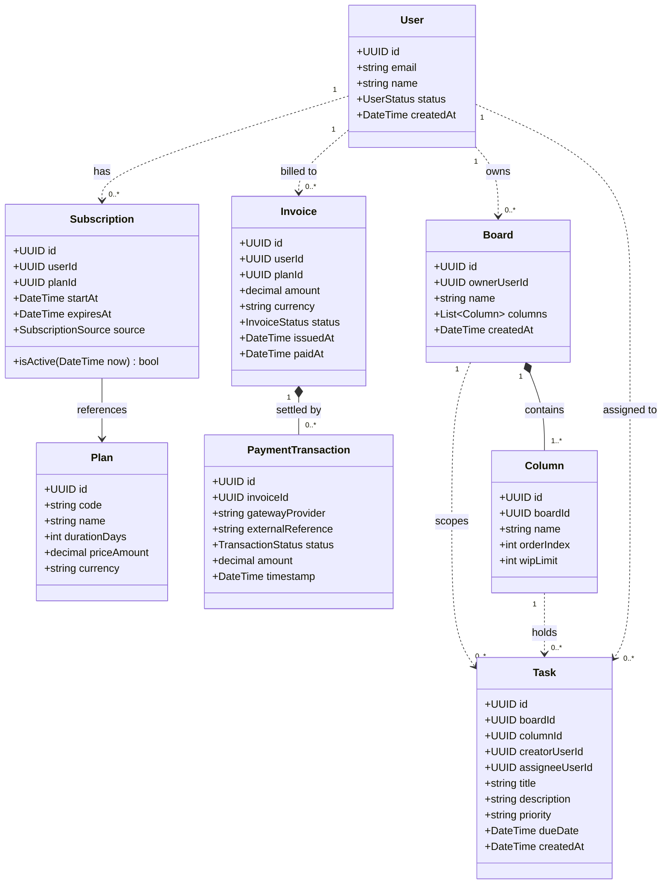
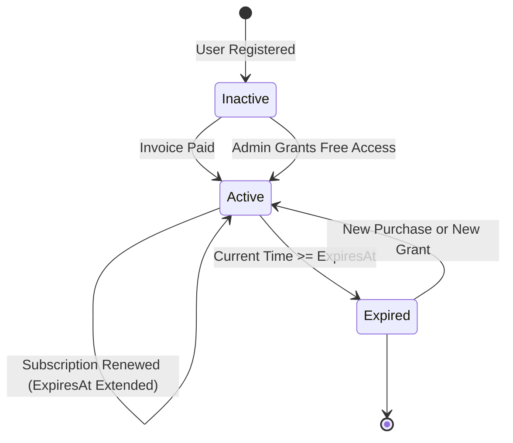
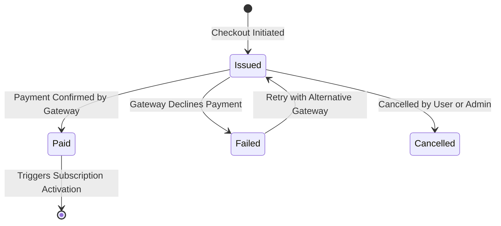
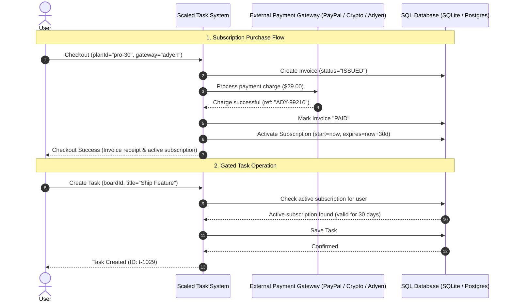

# Scaled Task Management System — Specification

A functional requirements and domain specification for a monetized SaaS task management platform with user identity, subscriptions, automated invoicing, and external payment integrations.

---

## 1. System Overview

The Scaled Task Management System builds upon task and board management by introducing multi-user tenancy, monetization, and subscription access control.

To use the system's board and task management features, each user must hold an **active subscription**. Subscriptions have defined start and expiration times, and may be acquired through paid checkout or granted directly for free by an administrator.

### Key Capabilities
* **User Identity**: Account registration and profile status management.
* **Subscription Management**: Tiered subscription plans with explicit time-window validity (`startAt` and `expiresAt`).
* **Subscription-Gated Operations**: Any creation, update, or movement of boards and tasks requires an active subscription. Un-subscribed or expired users are blocked.
* **Invoicing & Payments**: Automatic invoice generation for purchases and integration with multiple payment systems (**PayPal**, **Crypto**, **Adyen**).
* **Dual Interaction Interfaces**: Full feature parity across a Command-Line Interface (CLI) and a REST API.
* **Switchable SQL Persistence**: Runtime configuration to store data in either **SQLite** or **PostgreSQL**.

---

## 2. Domain Model & Entities



### Entity Summary
* **`User`**: Account holder with a status (`ACTIVE`, `SUSPENDED`).
* **`Plan`**: Commercial offering specifying duration (e.g., 30 days) and price.
* **`Subscription`**: Time-bounded entitlement linked to a user. Includes a validity window (`startAt` to `expiresAt`) and source (`PURCHASED` or `GRANTED_FREE`).
* **`Invoice`**: Commercial bill for a subscription purchase, tracking payment status (`DRAFT`, `ISSUED`, `PAID`, `FAILED`, `CANCELLED`).
* **`PaymentTransaction`**: Record of an attempt to settle an invoice through an external payment gateway.
* **`Board`**: Top-level workspace owned by a `User`, containing one or more workflow `Column`s.
* **`Column`**: Ordered stage within a board with optional WIP limits.
* **`Task`**: Unit of work scoped to a `Board` and `Column`, authored by a `creatorUserId` and optionally assigned to an `assigneeUserId`.

---

## 3. Business Rules & Invariants

### 3.1 Subscription Access Gate
* **The Access Rule**: A user **must have an active subscription** (`startAt <= current_time < expiresAt`) and an `ACTIVE` account status to create, modify, or move boards and tasks.
* If a user has no subscription, or if their subscription has expired, any board or task operation must be **rejected** with an `ACCESS_DENIED_SUBSCRIPTION_REQUIRED` error.

### 3.2 Subscription Acquisition & Renewal
* **Free Admin Grant**: An administrator can grant a subscription to any user for a specified duration in days (`source: GRANTED_FREE`). The grant takes effect immediately.
* **Paid Checkout**:
  1. The user initiates a purchase for a specific `Plan` and chooses a payment method.
  2. The system generates an `Invoice` with status `ISSUED`.
  3. The payment is processed through the selected payment gateway.
  4. Upon verified payment settlement, the invoice transitions to `PAID`.
  5. The user's subscription is activated (or extended if an active subscription already exists).
* **Renewal / Extension**: If a user already holds an active subscription and acquires another, the new duration is appended to the existing `expiresAt` timestamp.

### 3.3 Invoicing & Payment Integrity
* An invoice cannot be charged more than once after reaching `PAID` status.
* If a payment fails, the invoice transitions to `FAILED`, allowing the user to retry payment with the same or an alternative payment method.

---

## 4. State Machines & System Behavior

### 4.1 Subscription Lifecycle



### 4.2 Invoice & Payment Lifecycle



---

## 5. End-to-End Sequence: Purchase to Gated Task Creation



---

## 6. System Interfaces & Interactions

The system provides identical capabilities across CLI and REST API interfaces.

### 6.1 Command-Line Interface (CLI)

```bash
# 1. Register a user
$ scaled-cli user register --email "alice@example.com" --name "Alice"
User registered: ID 550e8400-e29b-41d4-a716-446655440000

# 2. Check subscription status (initially inactive)
$ scaled-cli subscription status --user-id 550e8400-e29b-41d4-a716-446655440000
Status: INACTIVE (No active subscription)

# 3. Attempting a task action fails due to access gate
$ scaled-cli task create --user-id 550e8400-e29b-41d4-a716-446655440000 \
                         --board-id "b1" --title "Setup Cluster"
[ERROR] AccessDenied: Active subscription required to perform task operations.

# 4. View plans
$ scaled-cli plan list
+---------+--------------+----------+----------+
| PLAN ID | NAME         | DURATION | PRICE    |
+---------+--------------+----------+----------+
| pro-30  | Professional | 30 Days  | $29.00   |
| ent-365 | Enterprise   | 365 Days | $299.00  |
+---------+--------------+----------+----------+

# 5. Purchase a subscription using Adyen (or paypal / crypto)
$ scaled-cli subscription buy --user-id 550e8400-e29b-41d4-a716-446655440000 \
                              --plan-id "pro-30" \
                              --gateway "adyen"
Invoice:      INV-2026-0091 ($29.00 USD)
Payment:      Adyen [SUCCESS] (Ref: ADY-tx-8839120)
Subscription: ACTIVE (Expires: 2026-12-03T13:30:00Z)

# 6. Admin Grant Free Subscription (Alternative path)
$ scaled-cli admin subscription grant --user-id 550e8400-e29b-41d4-a716-446655440000 \
                                      --plan-id "pro-30" \
                                      --days 60
Granted 60 days free subscription. New expiry: 2027-02-01T13:30:00Z.

# 7. Task action now succeeds
$ scaled-cli task create --user-id 550e8400-e29b-41d4-a716-446655440000 \
                         --board-id "b1" --column "Backlog" --title "Setup Cluster"
Task created successfully: ID t-1029
```

---

### 6.2 REST API Interface

#### Endpoints

| Area | Method | Endpoint | Description | Status Code |
|---|---|---|---|---|
| **Users** | `POST` | `/api/v1/users` | Register a new user | `201 Created` |
| **Users** | `GET` | `/api/v1/users/{userId}` | Get user profile and status | `200 OK` |
| **Subscription** | `GET` | `/api/v1/plans` | List subscription plans | `200 OK` |
| **Subscription** | `GET` | `/api/v1/users/{userId}/subscription` | Get user's active subscription | `200 OK` |
| **Subscription** | `POST`| `/api/v1/admin/users/{userId}/subscriptions/grant` | Admin grant free access | `200 OK` / `403 Forbidden` |
| **Billing** | `POST` | `/api/v1/users/{userId}/checkout` | Create invoice & process payment | `200 OK` / `422 Unprocessable` |
| **Billing** | `GET` | `/api/v1/invoices/{invoiceId}` | Get invoice and payment status | `200 OK` / `404 Not Found` |
| **Billing** | `POST` | `/api/v1/payments/{gateway}/webhook` | Payment confirmation callback | `200 OK` |
| **Tasks** | `POST` | `/api/v1/boards` | Create a board *(subscription gated)* | `201 Created` / `403 Forbidden` |
| **Tasks** | `POST` | `/api/v1/boards/{boardId}/tasks` | Create a task *(subscription gated)* | `201 Created` / `403 Forbidden` |
| **Tasks** | `PATCH`| `/api/v1/tasks/{taskId}/move` | Move a task *(subscription gated)* | `200 OK` / `403 Forbidden` |

#### Example: Checkout Request & Response

**Request (`POST /api/v1/users/{userId}/checkout`):**
```http
POST /api/v1/users/550e8400-e29b-41d4-a716-446655440000/checkout HTTP/1.1
Content-Type: application/json

{
  "plan_id": "pro-30",
  "gateway": "crypto",
  "payment_details": {
    "currency": "USDC",
    "wallet_address": "0x71C...39A"
  }
}
```

**Success Response (`200 OK`):**
```json
{
  "invoice_id": "inv_8829104",
  "amount": 29.00,
  "currency": "USD",
  "status": "PAID",
  "payment": {
    "gateway": "crypto",
    "transaction_reference": "0xfa918b99c...812d",
    "settled_at": "2026-11-03T13:30:15Z"
  },
  "subscription": {
    "status": "ACTIVE",
    "plan_code": "pro-30",
    "expires_at": "2026-12-03T13:30:15Z"
  }
}
```

#### Example: Gated Access Rejection (`403 Forbidden`)

When an un-subscribed or expired user attempts a task action:
```json
{
  "error": {
    "code": "SUBSCRIPTION_REQUIRED",
    "message": "Access denied: You must hold an active subscription to perform task management actions.",
    "user_id": "550e8400-e29b-41d4-a716-446655440000",
    "subscription_status": "EXPIRED",
    "expired_at": "2026-10-31T23:59:59Z"
  }
}
```

---

## 7. Technical & Infrastructure Requirements

### 7.1 Switchable SQL Databases
* All data (users, plans, subscriptions, invoices, boards, tasks) must be persisted in a relational SQL database.
* The system must support two switchable database engines:
  * **SQLite**: For lightweight setups, embedded CLI use, and automated tests.
  * **PostgreSQL**: For production, concurrent multi-user environments.
* The choice of database is configured at application startup without changing business logic or interface behaviors.

### 7.2 External Payment System Integrations
* The system must support checkout settlements using external payment providers:
  * **PayPal**: Hosted order authorization and capture.
  * **Crypto**: On-chain or payment-processor wallet settlements.
  * **Adyen**: Multi-method card and alternative payment processing.
* The payment provider is chosen per checkout request and verified before invoice status transitions to `PAID`.
