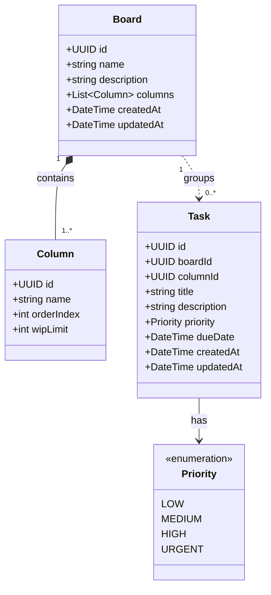
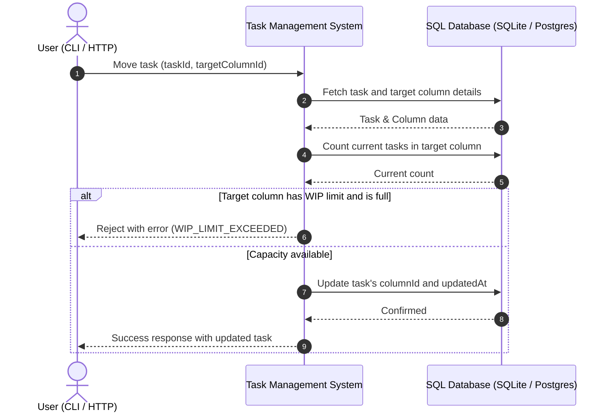

# Simple Task Management System — Specification

A functional requirements and domain specification for a Kanban-style task management system.

---

## 1. System Overview

The Simple Task Management System allows individuals and teams to organize, prioritize, and track tasks across visual boards and columns. The system enforces work-in-progress (WIP) limits per column to prevent bottlenecks and ensure smooth workflow management.

### Key Capabilities
* **Board & Column Management**: Create boards with customizable workflow columns and optional WIP limits.
* **Task Lifecycle**: Create, prioritize, and move tasks across workflow columns.
* **Dual Interaction Interfaces**: Full interaction via a Command-Line Interface (CLI) and a REST API.
* **Switchable SQL Persistence**: Data persistence using either **SQLite** (for local/embedded usage) or **PostgreSQL** (for multi-user/server deployments), selected via configuration when the system starts.

---

## 2. Domain Entities & Data Model



### Entity Definitions
* **`Board`**: Top-level container representing a project or workspace.
* **`Column`**: Ordered workflow stage within a board (e.g., *Backlog*, *In Progress*, *Review*, *Done*).
* **`Task`**: Unit of work belonging to a board and assigned to a specific column.
* **`Priority`**: Severity/urgency level (`LOW`, `MEDIUM`, `HIGH`, `URGENT`).

---

## 3. Business Rules & Invariants

1. **Board Structure**:
   * A Board must contain at least one column upon creation (default columns: `Backlog`, `In Progress`, `Done`).
   * Column names must be unique within a single board.
   * A column cannot be deleted if active tasks currently reside in it.

2. **Task Constraints**:
   * Every task must belong to an existing board and an existing column on that board.
   * Tasks can only be moved between columns that belong to the **same board**.

3. **Work-in-Progress (WIP) Limits**:
   * A column can optionally define a `wipLimit` ($> 0$).
   * If a column has a `wipLimit`, moving a task into that column must be **rejected** if the number of tasks already in that column equals or exceeds the limit.

4. **Error Conditions**:
   * `BOARD_NOT_FOUND`: Referenced board does not exist.
   * `COLUMN_NOT_FOUND`: Referenced column does not exist on the board.
   * `TASK_NOT_FOUND`: Referenced task does not exist.
   * `DUPLICATE_COLUMN_NAME`: A column with the requested name already exists on the board.
   * `COLUMN_NOT_EMPTY`: Cannot delete a column containing tasks.
   * `WIP_LIMIT_EXCEEDED`: Moving the task would exceed the destination column's WIP limit.

---

## 4. Expected System Behavior

### Task Movement Sequence



---

## 5. System Interfaces & Interactions

The system provides complete parity between its CLI and REST API.

### 5.1 Command-Line Interface (CLI)

```bash
# 1. Create a board
$ task-cli board create --name "Sprint 1" --description "Release MVP"
Board created:
ID:          3fa85f64-5717-4562-b3fc-2c963f66afa6
Name:        Sprint 1
Columns:     Backlog (unlimited), In Progress (limit: 3), Done (unlimited)

# 2. Add a column with a WIP limit
$ task-cli column add --board-id 3fa85f64-5717-4562-b3fc-2c963f66afa6 \
                      --name "QA Review" \
                      --wip-limit 2
Column 'QA Review' added with WIP limit 2.

# 3. Create a task
$ task-cli task create --board-id 3fa85f64-5717-4562-b3fc-2c963f66afa6 \
                       --column "Backlog" \
                       --title "Implement Login" \
                       --priority HIGH \
                       --due-date "2026-12-01"
Task created: ID 7c9e6679-7425-40de-944b-e07fc1f90ae7 [HIGH]

# 4. Move a task to another column
$ task-cli task move --task-id 7c9e6679-7425-40de-944b-e07fc1f90ae7 --to-column "In Progress"
Task 7c9e6679-7425-40de-944b-e07fc1f90ae7 moved to 'In Progress'.

# 5. List tasks on a board
$ task-cli task list --board-id 3fa85f64-5717-4562-b3fc-2c963f66afa6
+--------------------------------------+-----------------+-------------+----------+
| ID                                   | TITLE           | COLUMN      | PRIORITY |
+--------------------------------------+-----------------+-------------+----------+
| 7c9e6679-7425-40de-944b-e07fc1f90ae7 | Implement Login | In Progress | HIGH     |
+--------------------------------------+-----------------+-------------+----------+
```

---

### 5.2 REST API Interface

#### Endpoints

| Method | Endpoint | Description | Status Code |
|---|---|---|---|
| `POST` | `/api/v1/boards` | Create a board | `201 Created` |
| `GET` | `/api/v1/boards` | List all boards | `200 OK` |
| `GET` | `/api/v1/boards/{boardId}` | Get board details with columns | `200 OK` / `404 Not Found` |
| `POST` | `/api/v1/boards/{boardId}/columns` | Add a column to a board | `201 Created` / `400 Bad Request` |
| `POST` | `/api/v1/boards/{boardId}/tasks` | Create a task | `201 Created` / `422 Unprocessable` |
| `GET` | `/api/v1/boards/{boardId}/tasks` | List tasks on board (optional `?column_id=`) | `200 OK` |
| `PATCH`| `/api/v1/tasks/{taskId}/move` | Move task to a column | `200 OK` / `409 Conflict` |
| `DELETE`| `/api/v1/tasks/{taskId}` | Delete a task | `204 No Content` / `404 Not Found` |

#### Example: Move Task

**Request:**
```http
PATCH /api/v1/tasks/7c9e6679-7425-40de-944b-e07fc1f90ae7/move HTTP/1.1
Content-Type: application/json

{
  "target_column_id": "9b1deb4d-3b7d-4bad-9bdd-2b0d7b3dcb6d"
}
```

**Success Response (`200 OK`):**
```json
{
  "task_id": "7c9e6679-7425-40de-944b-e07fc1f90ae7",
  "board_id": "3fa85f64-5717-4562-b3fc-2c963f66afa6",
  "column_id": "9b1deb4d-3b7d-4bad-9bdd-2b0d7b3dcb6d",
  "column_name": "In Progress",
  "title": "Implement Login",
  "priority": "HIGH",
  "updated_at": "2026-11-03T13:20:00Z"
}
```

**WIP Limit Rejection Response (`409 Conflict`):**
```json
{
  "error": {
    "code": "WIP_LIMIT_EXCEEDED",
    "message": "Cannot move task to 'In Progress': column limit of 3 tasks has been reached.",
    "column_id": "9b1deb4d-3b7d-4bad-9bdd-2b0d7b3dcb6d",
    "current_count": 3,
    "limit": 3
  }
}
```

---

## 6. Technical & Storage Requirements

* **Relational Storage**: The system requires persistent storage for boards, columns, and tasks.
* **Switchable Database Engines**:
  * **SQLite**: Used for standalone CLI executions, local usage, and lightweight environments.
  * **PostgreSQL**: Used for client-server multi-user deployments.
* **Selection Mechanism**: The storage engine is selected via system configuration (e.g., `DB_DRIVER=sqlite` or `DB_DRIVER=postgres`) during application startup without altering functional behavior.
